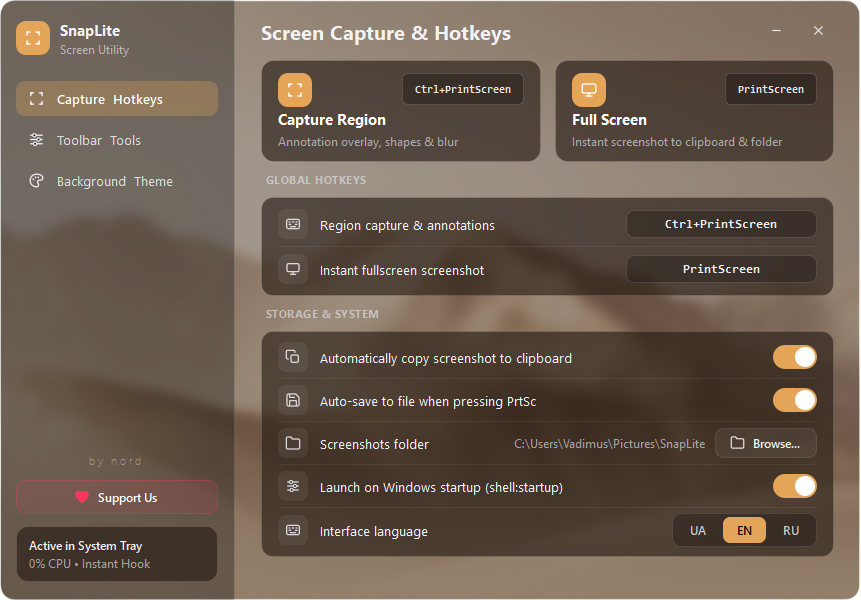
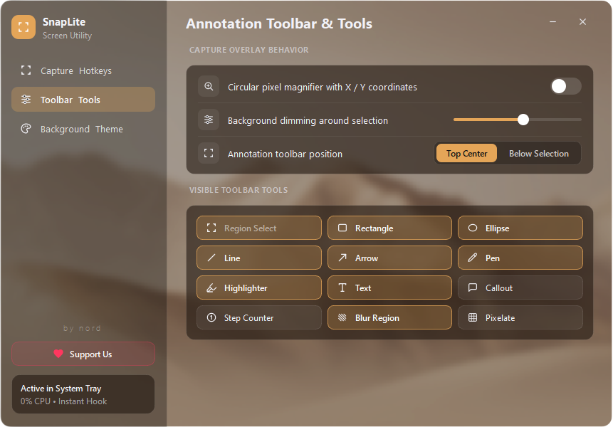
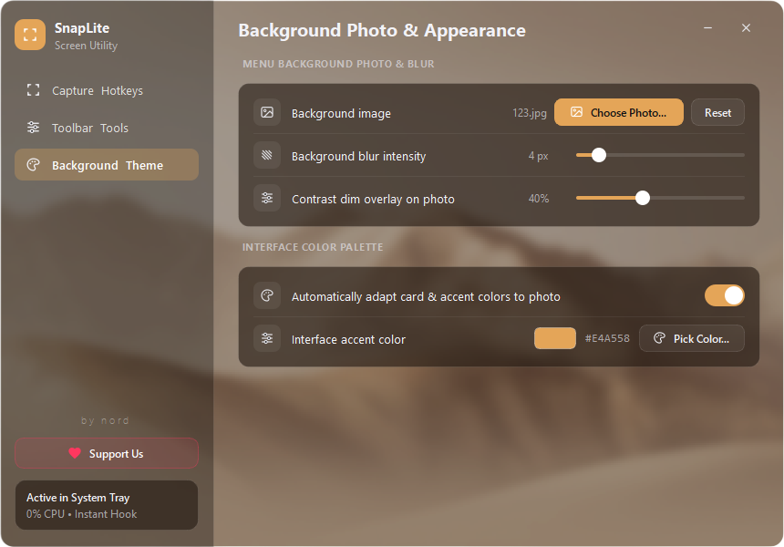
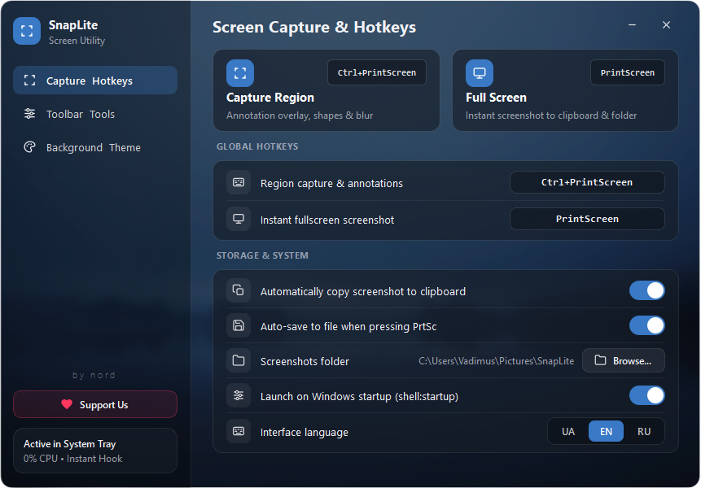
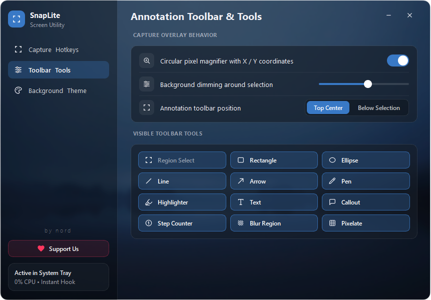
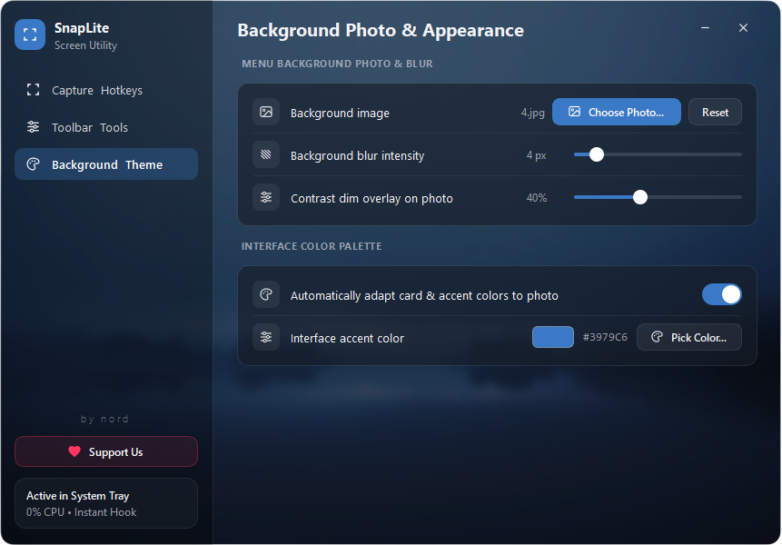
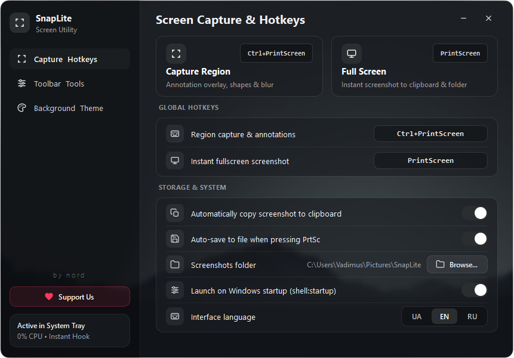
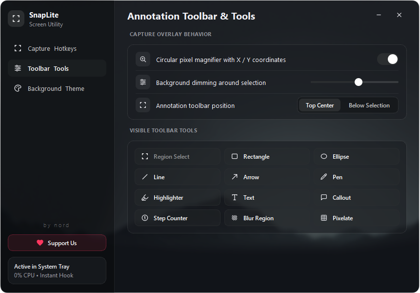
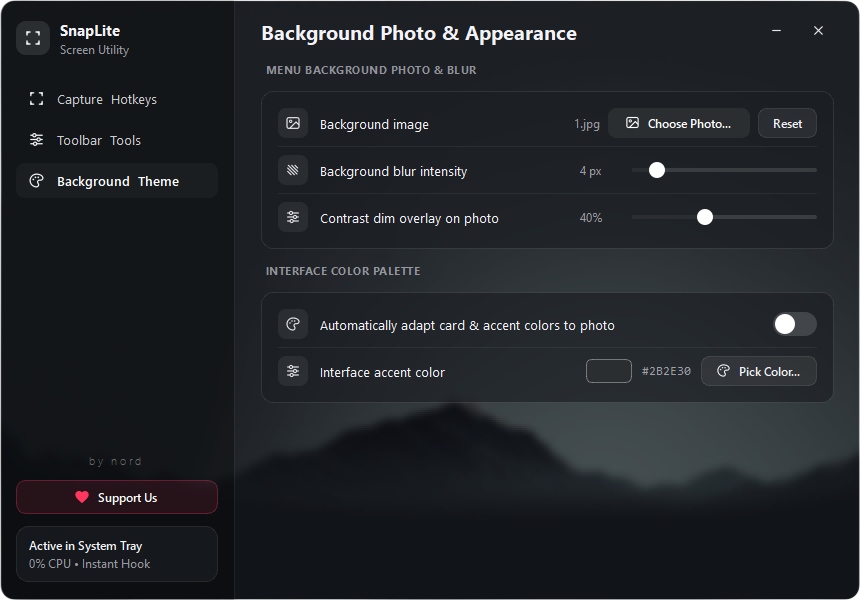

# SnapLite

**SnapLite** is a lightweight, blazing-fast, and customizable screenshot and annotation utility for Windows (**by nord**).

---

## ✨ Features

- **Instant Screen Capture (0% Idle CPU)**: Low-level Win32 keyboard hook (`PrintScreen` & `Ctrl+PrintScreen`) and hardware-accelerated Win32 GDI screen capture.
- **Rich Annotation Toolkit**: Rectangle, Ellipse, Line, Arrow, Freehand Pen, Highlighter, Text, Callout bubbles, Step counters, Blur, and Pixelate.
- **Circular Pixel-Grid Magnifier**: Real-time crosshair inspection with exact `X / Y` pixel coordinates for pixel-perfect crops.
- **Custom Menu Background & Adaptive Theme**: Set your own background image with adjustable blur and contrast dimming, or let SnapLite automatically extract accent colors from your wallpaper.
- **Localization**: Built-in support for English (`EN`), Ukrainian (`UA`), and Russian (`RU`).
- **Windows Startup Integration**: Seamlessly enable or disable autostart on system boot via `shell:startup`.

---

## 🎨 Interface & Customization

SnapLite offers extensive aesthetic and functional personalization, allowing the interface to seamlessly blend into your desktop workflow:

- **Custom Menu Background**: Select any custom image or photo for the settings window with real-time live preview.
- **Adjustable Blur & Contrast Dimming**: Fine-tune background blur radius and dark contrast overlay for optimal readability.
- **Smart Adaptive Theming**: Automatically extracts matching card palettes and accent tones directly from your chosen wallpaper or photo.
- **Custom Accent Color Picker**: Choose any custom HEX accent color to highlight buttons, sliders, and active controls.
- **Configurable Annotation Tools & Overlay**: Customize toolbar position, selection dimming opacity, and the circular pixel-grid magnifier crosshair.
- **Multi-Language Support**: Built-in support for English (`EN`), Ukrainian (`UA`), and Russian (`RU`).

### Theme Showcase

SnapLite adapts its interface cards, controls, and typography to complement your selected background:

#### 🏜️ Warm Sand / Earth
| Screen Capture & Hotkeys | Annotation Toolbar | Background & Appearance |
| :---: | :---: | :---: |
|  |  |  |

#### 🌊 Deep Oceanic
| Screen Capture & Hotkeys | Annotation Toolbar | Background & Appearance |
| :---: | :---: | :---: |
|  |  |  |

#### 🌑 Obsidian Dark
| Screen Capture & Hotkeys | Annotation Toolbar | Background & Appearance |
| :---: | :---: | :---: |
|  |  |  |

---

## 🚀 Getting Started

### Prerequisites

Ensure you have Python 3.10+ installed on your Windows machine.

### Installation & Running from Source

```bash
git clone https://github.com/nordnord1/SnapLite.git
cd SnapLite
pip install -r requirements.txt
python main.py
```

### Build Standalone Executable (.exe)

Compile the application into a single portable `.exe` with embedded icon and zero console window:

```bash
pyinstaller --noconfirm --onefile --windowed --name "SnapLite" --icon "icon.ico" --add-data "icon.ico;." --hidden-import "PyQt6.QtSvg" --hidden-import "PyQt6.QtCore" --hidden-import "PyQt6.QtGui" --hidden-import "PyQt6.QtWidgets" --hidden-import "PIL" main.py
```

The compiled binary will be generated in `dist/SnapLite.exe`.

---

## ❤️ Support Us

If you find **SnapLite** useful and want to support its ongoing development and new features, you can donate via cryptocurrency directly to the author (**by nord**):

- **Ethereum (ETH / ERC-20):**
```text
0x2168A8e00f503D61cDe7C878321531c17C9D6089
```
- **TON:**
```text
UQAZ2pLXFMrCS2DShL4i94VCXv76pRHgUU83cW56sv_CE9Ui
```
- **Tron (TRX / TRC-20):**
```text
TQj86sAZqMg8NeYksT1ZCzKV4TCjtU2PUA
```
- **Bitcoin (BTC):**
```text
bc1qcl7rmmc08pum6gljc45rq4004k5azktqp9lsge
```

---

## 📜 License

This project is licensed under the **Source-Available / Non-Commercial License** ([LICENSE](LICENSE)).

- **Allowed**: Free personal use, educational code study, and non-commercial forks.
- **Requirement**: The original author attribution **`by nord`** must be preserved in all copies, forks, derivatives, and user interfaces.
- **Prohibited**: Commercial redistribution, sale, or sublicensing of the software or any modified versions.
